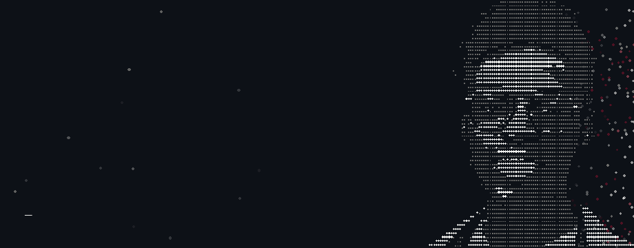

ML and robotics, Nairobi.

I train models and build the systems around them. Kenyan Sign Language, imitation learning for robot arms, and GPU compute for Intel Arc from Mojo.

[williamobino.staka.cc](https://williamobino.staka.cc)

**Now**

- Ishara Soma v1, sign to text, in public preview
- mojo-intel-gpu, on the Modular community channel

**Elsewhere**

[LinkedIn](https://linkedin.com/in/williamobino) · [Hugging Face](https://huggingface.co/Cloudsurfer48902) · obinowilliam@gmail.com
